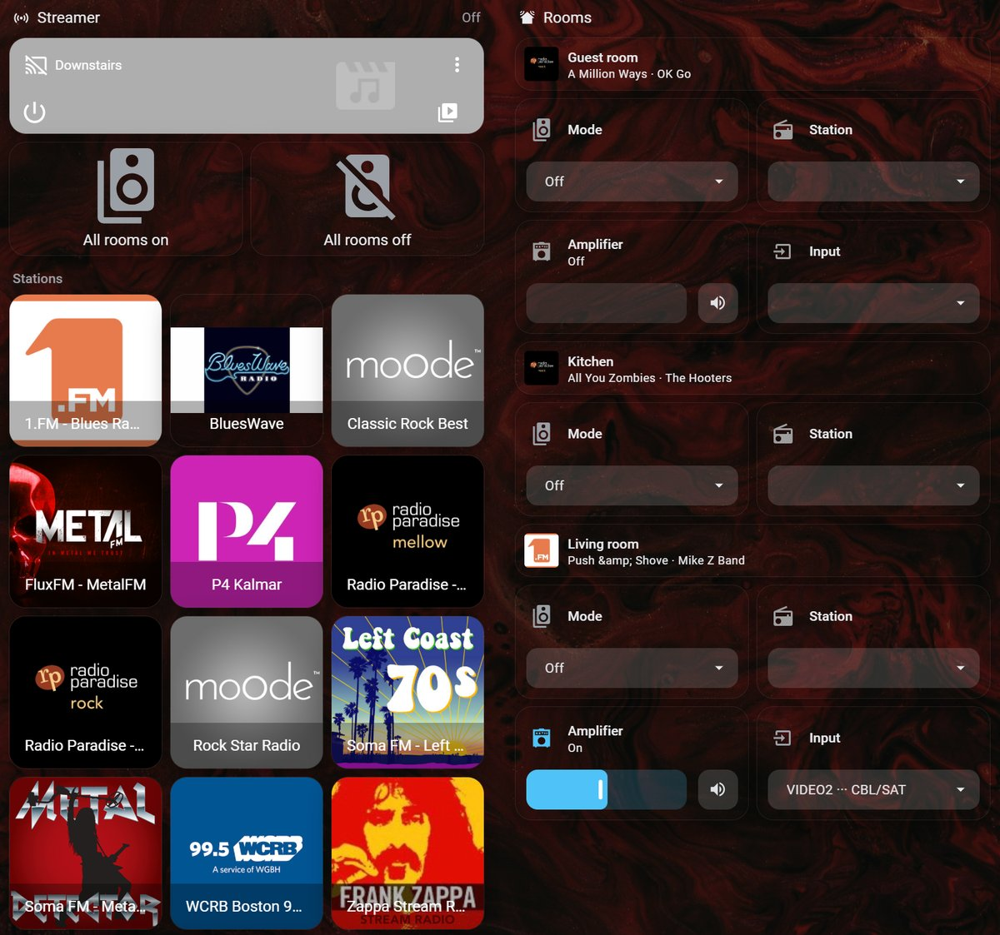
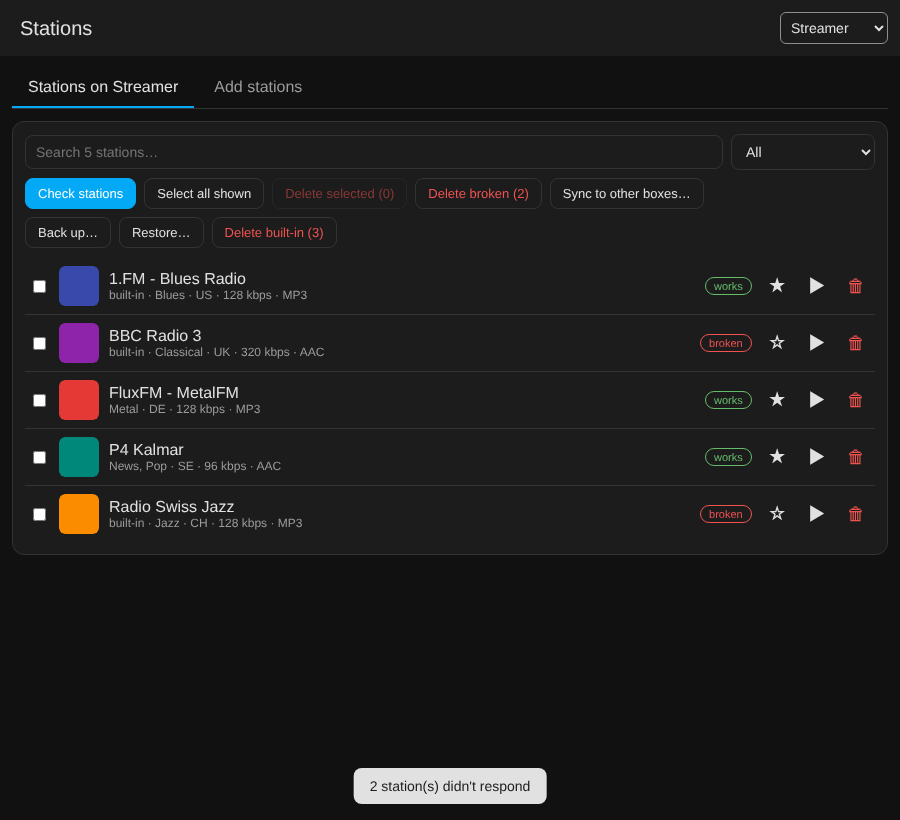

<p align="center"></p>

# moOde Audio for Home Assistant

Control your [moOde audio](https://moodeaudio.org) players and multiroom zones from Home Assistant: per-room control, a station manager, amplifier control and a dashboard that builds itself.

[](https://github.com/Sanfeld/ha-moode/actions/workflows/validate.yml)
[](https://github.com/Sanfeld/ha-moode/actions/workflows/tests.yml)

[](https://my.home-assistant.io/redirect/hacs_repository/?owner=Sanfeld&repository=ha-moode&category=integration)



<details><summary>Stations manager</summary>



</details>

## Features

- **Finds your boxes automatically** on the network, or add them by IP address or hostname.
- **A media player per box**: play, pause, skip, seek, cover art, and volume (hidden for fixed-volume setups).
- **Instant updates**: changes made anywhere (moOde's web page, phone apps) show up in HA right away.
- **Multiroom zones**: pick a sender and its receivers. Every room can be set to **Zone** (plays along), **Solo** (plays its own station) or **Off**. A zone player switches everything on or off, and **All rooms on** resumes the music.
- **Stations**: favourite-station buttons with logos, an *All stations* dropdown, *Recently played*, and a per-room station picker.
- **Stations manager** (dashboard tab): check every stream and remove dead ones, bulk delete, ★ favourites, **edit** stations (name, URL, logo upload), add stations from the **radio-browser.info** directory (~50,000 stations), **back up / restore**, and **sync** station lists between boxes.
- **Music library** (dashboard *FLACs* tab): browse the music stored on a box by **artist**, **album** (with cover art) and **genre**, search it, see **recently added** albums, and play, **shuffle** (an album, artist, genre or everything) or **add to the queue**. It plays on that box and its zone.
- **Amplifier control**: link the amp each box feeds and get its power, volume and input on the dashboard.
- **Sleep timer** with fade-out, **announcements** (TTS pauses the music and resumes it), and **voice search** for Assist.
- **Health warnings** in *Settings → Repairs* (box offline, no internet, receiver disabled in moOde), plus **diagnostics** download.
- **Automation blueprints**: amps follow the zone, pause for the doorbell, morning radio.

## Requirements

- Home Assistant **2025.2** or newer.
- moOde audio **9.x** (developed against 9.4.2) on your players.
- For cover art and track details: turn on **Metadata file** in each box's moOde settings.

## Install

**Marketplace (recommended):** click the button above, or open *Settings → Marketplace*, search for **moOde Audio** and install. (Before it's in the catalog: *Marketplace → ⋮ → Add from link* with `https://github.com/Sanfeld/ha-moode`, type *Integration*.)

**Manual:** copy `custom_components/moode` into your Home Assistant `config/custom_components/` folder and restart.

## Setup

1. Your boxes show up under **Settings → Devices & services → Discovered**. Click **Add** for each, or use *Add integration → moOde Audio* with an IP address or hostname.
2. For multiroom: when you add a box, choose its role (**Receiver** in an existing zone, **Sender** or **Stand-alone**) and Home Assistant sets it up in moOde's *Configure → Multiroom* for you: a receiver gets the zone's multicast address and the settings of a room that already works, and joins the zone. For a box that's already added, use the action `moode.provision_multiroom` (it can also just show what it would change). You can still set roles by hand in moOde and tick receivers under *moOde Audio → sender → Configure → Multiroom zone*.
3. Optional per box, under **Configure**: *Favourite stations*, *Amplifier*, *Volume control* (Fixed if an amp does the volume), *Sleep timer* and *Announcements*.

### Dashboard (builds itself)

Create a new dashboard. In its **Raw configuration editor**, replace everything with:

```yaml
strategy:
  type: custom:moode-music
```

You get **Music** (sender, stations, rooms, amps), **Stations** (the manager) and **Settings** tabs, rebuilt from your current setup every time the dashboard opens. New boxes, favourites and amps appear without editing anything. The Stations manager is also available as a card: `type: custom:moode-stations-card`.

### Blueprints

Import from `blueprints/automation/moode/` (*Settings → Automations → Blueprints → Import*):

| Blueprint | What it does |
|---|---|
| Amps follow zone | Switches amplifiers on and off with the zone, with an optional input, an off delay, and on-when-playing or on-when-on behaviour |
| Doorbell pause | On a doorbell ring, pauses the music or turns the volume down (players or amplifiers), optionally announces it, then goes back to normal after a time you choose. Also works from a phone or tablet's "Last notification" sensor, for doorbells whose rings don't reach Home Assistant directly |
| Morning radio | Plays a favourite at a set time on chosen days, optionally only when someone's home |

## Good to know

- **Wired boxes:** turn Wi-Fi off on boxes connected by cable. Multicast (multiroom) and internet radio both behave better with one network connection.
- **Raspberry Pi + AV receiver over HDMI** can drop out briefly. A USB DAC or the Pi's analog output into the receiver avoids it.
- Station edits and logos go through moOde's own Radio Manager endpoints, so moOde's database, station files and logos stay consistent.
- No cloud: everything is local. The Stations manager only uses the internet to search radio-browser.info and to check streams.

## Support

This is a community project, not part of Home Assistant or moOde. Please report problems in [Issues](https://github.com/Sanfeld/ha-moode/issues), and attach the box's **diagnostics** file (*moOde Audio → ⋮ → Download diagnostics*).

## License

MIT
